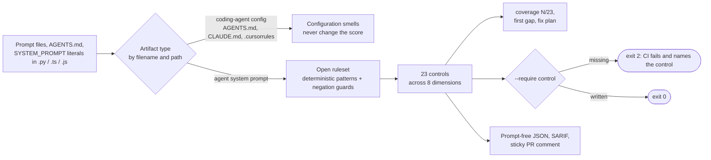

<div align="center">


# CrewScore

### Find missing written safeguards before your AI assistant goes live.

**An offline linter that checks an AI agent's system prompt against 23 published controls (injection defense, human approval, cost limits, stop conditions) and fails CI when a control you require is missing. No model, no API key, open rules.**

[](https://pypi.org/project/crewscore/)
[](https://pypi.org/project/crewscore/)
[](https://github.com/shmindmaster/crewscore/actions/workflows/pytest.yml)
[](https://github.com/marketplace/actions/crewscore)
[](https://github.com/shmindmaster/crewscore/blob/main/LICENSE)

**[Try it live in your browser, no install →](https://crewscore.ai/)**

[Quickstart](#quickstart-30-seconds) · [Watch the film](#see-it-run) · [How it works](#how-it-works) · [CI](#ci) · [Guardrails](#guardrails) · [Status and limits](#status-and-limits)

</div>

> Created and maintained by **Sarosh Hussain**, an independent open-source
> maintainer. Technical claims are grounded in the
> code, tests, and cited validation material.

---

## Why it exists

A support assistant ships on Friday. Does its prompt say a human approves a
refund? Does it say what to do with instructions hidden in a customer's
message, or when to stop? Usually nobody checks, because checking means reading
every prompt by hand, and runtime red-teaming is slow, paid and hard to
reproduce.

**We scanned 356 publicly collected agent prompts: 83 production-labeled prompts and 273
general-purpose prompts. Among the production-labeled subset, median coverage was 10
of 100.** GPT-Store median: 0 of 100.
[Numbers →](https://github.com/shmindmaster/crewscore/blob/main/docs/validation-corpus.md) · [Shareable card →](https://raw.githubusercontent.com/shmindmaster/crewscore/main/docs/corpus-card.svg)

CrewScore makes the written part cheap to check. It reads prompt files, and
`SYSTEM_PROMPT` / `system_prompt` string literals in `.py`, `.ts` and `.js`
source, and reports which of 23 published controls are written down. It
proposes wording for each gap and never edits your file. In CI you name the
controls your workflow needs, and the build fails only when one of those is
missing.

**Public-good thesis:** written safeguards should be inspectable with an
offline, open ruleset before teams depend on runtime claims that are harder to
reproduce or independently review.

## Quickstart (30 seconds)

```bash
pip install crewscore
mkdir -p prompts && echo "You are a friendly support assistant for an online store." > prompts/support.md

crewscore test --prompt-file prompts/support.md            # coverage N/23 and the first gap to review
crewscore fix --prompt-file prompts/support.md --plan      # proposed wording for each gap; writes nothing
crewscore scan . --require human_gate.approval_required    # exit 2: the required control is missing

echo "A human must approve any refund or account change before it happens." >> prompts/support.md
crewscore scan . --require human_gate.approval_required    # exit 0: the control is written down
```

Python 3.11 or later. Everything runs locally: no account, no network call, no
LLM.

## See it run

<a href="https://saroshhussain.com/films/crewscore-one-sentence.mp4">
  
</a>

**[Watch the 90-second film →](https://saroshhussain.com/films/crewscore-one-sentence.mp4)**
A one-line support prompt covers 0 of 23 controls. The release gate requires a
human-approval rule and fails with exit 2. One sentence, written by a person,
turns it to exit 0, and the film ends in the rule source that matched it.


## How it works



Each rule is a deterministic pattern with guards, so "do not ask permission"
never counts as a human-approval rule. Several rules roll up to one control, and
the gate checks controls by name rather than an average.
[How scoring works →](https://github.com/shmindmaster/crewscore/blob/main/docs/scoring-and-controls.md) ·
[Architecture →](https://github.com/shmindmaster/crewscore/blob/main/docs/architecture.md)

## Guardrails

- **Offline and deterministic.** No model, no API key, no network; the same input always gives the same findings.
- **Writes nothing by default.** `fix --plan` proposes wording; a person decides what goes in the prompt.
- **Gate on named controls, never the average.** `--require` and `required-controls` fail only on the controls you name.
- **CI output is prompt-free.** Logs, JSON, Markdown and SARIF carry rule IDs and control labels, never the matched prompt text.
- **Config files are not scored as prompts.** `AGENTS.md` and similar files get a smell verdict, not a governance grade.
- **Every scoring change is measured.** The [CHANGELOG](https://github.com/shmindmaster/crewscore/blob/main/CHANGELOG.md) records each change and its corpus delta.

---

## Read this first

**CrewScore is a checklist, not a benchmark.** The number is the share of **23
published controls** your prompt states — nothing about whether they are well
specified, mutually consistent, or obeyed at runtime.

| What the prompt does | What it scores |
| --- | --- |
| Nothing written down | **0** |
| One control in each of the 8 dimensions | **36** |
| All 23 controls | **100** |
| One control restated five different ways | same as stating it once |

So a **low score is actionable** — you probably have not written down an
injection policy, a human gate, or a safe-stop rule, and those are worth
writing. A **high score means the text is present**, not that the agent obeys
it. Don't rank prompts, teams, or vendors by this number, and don't treat a
threshold as a safety bar. Prefer the findings to the total.

Three dimensions — **Cost**, **Compliance**, **Audit** — ship with known-thin
construct validity and say so. Ruleset `0.6.0` tightened their patterns against
measured corpus false positives; Compliance is still not lawful handling.

📄 **[The validation study →](https://github.com/shmindmaster/crewscore/blob/main/docs/validation.md)** — including the arithmetic
showing our own scale was broken through `0.1.0`, which we published before
fixing.

📊 **[Measured against 356 publicly collected prompts →](https://github.com/shmindmaster/crewscore/blob/main/docs/validation-corpus.md)** —
Cliff's δ = 0.614 separating production-labeled agent prompts from general-purpose
ones, generated by a committed harness rather than typed by hand.

---

## Usage

```bash
crewscore scan .                          # prompts + AGENTS.md + inline SYSTEM_PROMPT=...
crewscore scan . --no-inline              # file discovery only
crewscore init .                          # prompt-free regression baseline + PR workflow
crewscore scan . --fail-on-regression --baseline .crewscore-baseline.json
crewscore scan . --require human_gate.approval_required   # one-control CI habit
crewscore test --prompt-file ./prompt.md  # coverage N/23 + first gap to review
crewscore fix  --prompt-file ./prompt.md --plan   # what's missing, no writes
crewscore rules --concepts                # the 23 controls, and the rules behind them
```

**[Full CLI reference →](https://github.com/shmindmaster/crewscore/blob/main/docs/cli.md)** · **[How scoring works →](https://github.com/shmindmaster/crewscore/blob/main/docs/scoring-and-controls.md)**

---

## CI

Start report-only — it never fails a build:

```yaml
- uses: shmindmaster/crewscore@v2
  with:
    scan-path: "."
```

When you know which controls your workflow actually needs, name them — the
build then fails only when a named control is missing, never on the coverage
average:

```yaml
- uses: shmindmaster/crewscore@v2
  with:
    scan-path: "."
    required-controls: "human_gate.approval_required,safe_stop.stop_condition"
    sarif: "crewscore.sarif"
```

Posts a sticky PR comment with the open rule findings (give the job
`permissions: pull-requests: write`; without it the action logs a warning and
moves on). Failed gates surface as `::error` annotations naming the control.

CI output is **prompt-free by default**: rule IDs, dimensions, status, and
control labels — never the matched text of the prompt that was scanned, because
that build log is more public than the prompt is. `include-snippets: "true"`
re-admits it to JSON and Markdown output and is deprecated; it will be removed
after one release. SARIF remains prompt-free regardless of that input.
Guard downstream steps on the `scored` output, not on `score` — an empty
score casts to `0`.

**[Action inputs, outputs, and the CLI variant →](https://github.com/shmindmaster/crewscore/blob/main/docs/github-action.md)**

---

## Two artifacts, two rulesets

CrewScore judges two kinds of file, and tells you which it thinks it is looking
at. Detection is by filename and path — never by sniffing content.

| Artifact | Examples | Judged on |
|----------|----------|-----------|
| **Coding-agent config** | `AGENTS.md`, `CLAUDE.md`, `.cursorrules` | Configuration smells |
| **Agent system prompt** | `system-prompt.md`, anything under `prompts/` or `agents/` | The 8 governance dimensions |

A file saying *"always use pnpm"* is telling a coding agent how to work in your
repo. It has no reason to contain HIPAA language, and scoring it against that
is a category error.

We know the size of that error because we measured it: against the 100
most-starred repos with an `AGENTS.md`
([arXiv:2606.15828](https://arxiv.org/abs/2606.15828)), the governance ruleset
put **all 100 in the worst tier**. A scale the entire population fails carries
no information. So config files get a smell verdict instead — and in `--json`,
no governance grade at all.

```bash
crewscore test --prompt-file AGENTS.md
# -> CONFIG: NO SMELLS DETECTED   (not "0/100 CRITICAL GAPS")
```

---

## Configuration smells

Problems in the *shape* of an instruction file rather than its content, from a
published catalog —
[*Configuration Smells in AGENTS.md Files*](https://arxiv.org/abs/2606.15828)
(dos Santos et al., 2026), which found **91 of 100** popular projects carried
at least one.

| Smell | Heuristic | Found in |
|-------|-----------|----------|
| **Context Bloat** | ≥ 200 lines | 42% of studied projects |
| **Lint Leakage** | Style rules a configured linter already enforces | 62% |
| **Init Fossilization** | Tracked by git with exactly one commit | 24% |

The paper's other three smells need an LLM to detect. We would rather ship
three honest detectors than six approximate ones. Lint Leakage is an
approximation of the paper's detector and says so in its output; Init
Fossilization cannot tell "never needed revising" from "never got revised."

**Smells never change the score.** Folding them in would silently change what
every existing `--threshold` means.

---

## Docs

| | |
|---|---|
| [Validation](https://github.com/shmindmaster/crewscore/blob/main/docs/validation.md) | What the number does and does not measure |
| [Corpus validation](https://github.com/shmindmaster/crewscore/blob/main/docs/validation-corpus.md) | Generated result over 356 publicly collected prompts |
| [Scoring and controls](https://github.com/shmindmaster/crewscore/blob/main/docs/scoring-and-controls.md) | Formula, 23 controls, charter, governance |
| [CLI](https://github.com/shmindmaster/crewscore/blob/main/docs/cli.md) | Every command and flag |
| [GitHub Action](https://github.com/shmindmaster/crewscore/blob/main/docs/github-action.md) | Action inputs/outputs and CLI-in-CI |
| [Policies and SARIF](https://github.com/shmindmaster/crewscore/blob/main/docs/policies.md) | Regression and required-control CI without score gating |
| [Architecture](https://github.com/shmindmaster/crewscore/blob/main/docs/architecture.md) | Modules, data flow, lean target |
| [Development](https://github.com/shmindmaster/crewscore/blob/main/docs/development.md) | Local setup, rules, packaging, media |
| [Live eval handoff](https://github.com/shmindmaster/crewscore/blob/main/docs/next-steps-eval.md) | Promptfoo / garak after structural gate |
| [Roadmap](https://github.com/shmindmaster/crewscore/blob/main/docs/roadmap.md) | Available work and deliberately deferred capabilities |
| [Security](https://github.com/shmindmaster/crewscore/blob/main/SECURITY.md) | Private vulnerability reporting |
| [Community discussions](https://github.com/shmindmaster/crewscore/discussions) | Questions, adoption feedback, and open-ended ideas |
| [Comparison](https://github.com/shmindmaster/crewscore/blob/main/docs/comparison.md) | Other tools, and what to use after this one |
| [CHANGELOG](https://github.com/shmindmaster/crewscore/blob/main/CHANGELOG.md) | Including every scoring change and its measured delta |

---

## Status and limits

**Current release:** see [PyPI](https://pypi.org/project/crewscore/) and the
[CHANGELOG](https://github.com/shmindmaster/crewscore/blob/main/CHANGELOG.md).
Ruleset `0.6.0`. The GitHub Action is `shmindmaster/crewscore@v2`, and the
checker at [crewscore.ai](https://crewscore.ai/) runs the same engine locally
in your browser. The project is **Alpha**: the JSON payload and exit codes can
still change between releases, and every change is recorded.

What this is not: live adversarial red-teaming, runtime tool-gate enforcement,
a security or compliance certification, or proof that the model will obey the
text. Three dimensions (Cost, Compliance, Audit) ship with disclosed thin
construct validity. For runtime testing after the structural gate, see the
[live eval handoff](https://github.com/shmindmaster/crewscore/blob/main/docs/next-steps-eval.md)
to Promptfoo or garak.

**Roadmap:** framework adapters that extract prompts from LangGraph, CrewAI and
AutoGen graphs, and optional live adversarial testing (not the default path).
See the [roadmap](https://github.com/shmindmaster/crewscore/blob/main/docs/roadmap.md).

## Contributing, security and license

- **Contributing:** read [CONTRIBUTING.md](https://github.com/shmindmaster/crewscore/blob/main/CONTRIBUTING.md)
  and the [development guide](https://github.com/shmindmaster/crewscore/blob/main/docs/development.md).
  A new rule needs a corpus measurement and a negative test. Good first issues are labelled
  [`good first issue`](https://github.com/shmindmaster/crewscore/labels/good%20first%20issue);
  questions go to [Discussions](https://github.com/shmindmaster/crewscore/discussions).

  ```bash
  git clone https://github.com/shmindmaster/crewscore.git
  cd crewscore
  pip install -e ".[dev]"
  pytest
  ```

- **Security:** report vulnerabilities privately through a
  [GitHub security advisory](https://github.com/shmindmaster/crewscore/security/advisories/new),
  as described in [SECURITY.md](https://github.com/shmindmaster/crewscore/blob/main/SECURITY.md).
- **License:** [MIT](https://github.com/shmindmaster/crewscore/blob/main/LICENSE) ·
  [Governance](https://github.com/shmindmaster/crewscore/blob/main/GOVERNANCE.md) ·
  [Roadmap](https://github.com/shmindmaster/crewscore/blob/main/ROADMAP.md)

Related open source by the same maintainer: [Assay](https://github.com/shmindmaster/assay)
keeps an agent's decision out of its side effects, and
[GitPin](https://github.com/shmindmaster/gitpin) makes agent-authored pull
requests carry exact, re-checkable evidence. More at
[saroshhussain.com](https://saroshhussain.com).
