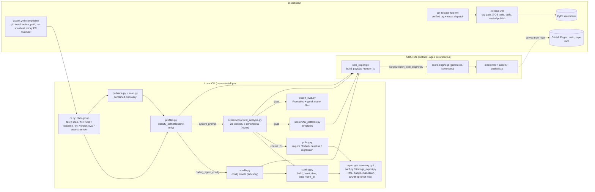

# Technical verification

Read from the code at `e9a1c9b`; nothing was executed. For the maintained
architecture text see [architecture](../architecture.md); this page adds the
diagram, the delivery pipeline, and a traced critical path.

## Architecture

The browser checker is a **separate local engine**: it runs `score-engine.js`
in the page, not the Python CLI. Parity is enforced by tests, not by sharing a
runtime (`tests/test_web_engine.py`, and the "Web engine must not be stale" step
in `release.yml`).

## Layers

| Layer | Files |
|---|---|
| Entry | `crewscore/cli.py` (1,943 lines; `main` at `:222`), console scripts `crewscore` and legacy `agent-guard` in `pyproject.toml` |
| Classify | `crewscore/profiles.py:74` |
| Match | `crewscore/scorers/structural_analysis.py` (778 lines), `crewscore/smells.py` |
| Score | `crewscore/scoring.py` |
| Policy | `crewscore/policy.py`; config is a small hand-rolled `.crewscore.yml` reader (`policy.py:89`), no YAML dependency |
| Output | `report.py`, `summary.py`, `sarif.py`, `findings_export.py` |
| Discovery | `scan.py`, `pathsafe.py` |
| Browser | `web_export.py`, `score-engine.js`, `index.html`, `analytics.js` |
| Handoff | `export_eval.py` |

Runtime dependencies are only `click` and `rich` (`pyproject.toml`). The
package has no model SDK and makes no network call on the scoring path.

## Data

- **No database, no server, no queue, no tenancy.**
- Inputs are local files or a string. Outputs are stdout, optional files
  (`--report`, `--badge`, `--summary`, `--sarif`, baseline JSON, `fix --output`).
- Published statistics (`docs/validation-corpus.json`, `docs/corpus-scores.*`)
  are generated by `scripts/validate_corpus.py`. Third-party prompt corpora are
  **fetched at pinned SHAs and not vendored** (for example
  `scripts/validate_corpus.py:158`). Synthetic fixtures live in
  `examples/corpus/` and `tests/fixtures/`.
- Browser prompt text stays in page memory. Shared result links are unsigned
  fragments, validated as untrusted input ([development](../development.md)).

## Auth and secrets

- The product needs **no credential and no API key**. There is no `.env`
  example because none is required.
- Release uses **PyPI Trusted Publishing (OIDC)**, confirmed in
  `.github/workflows/release.yml`: the `publish` job runs in environment
  `pypi` with `id-token: write`, uses `pypa/gh-action-pypi-publish` with
  `attestations: true`, and the file states there is deliberately no
  `PYPI_TOKEN` secret. The PyPI-side registration works: release run
  38735565259 published 0.6.14 through it on 2026-10-15.
- The Action takes the default `github.token` for the sticky PR comment only.
  User inputs reach the shell through `env:` variables, never interpolated into
  command text (`action.yml`); a test covers the manifest
  (`tests/test_action_manifest.py`).
- Workflow actions are pinned by commit SHA in the workflows read.

## CI/CD

| Workflow | Trigger | Purpose |
|---|---|---|
| `pytest.yml` | push to main, pull_request | Python 3.11/3.12/3.13 `pytest -q`; dependency-floor job; Playwright browser job (Chromium, Firefox, WebKit) |
| `crewscore-selftest.yml` | push to main, pull_request | Runs the local Action on `examples/`, asserts outputs and exit 2 under a threshold |
| `release.yml` | semver tag `v*.*.*`, manual dispatch (dry-run default) | Version/tag gate, stale-engine gate, Linux/Windows/macOS verify, build, wheel smoke test, then `publish` to PyPI |
| `cut-release-tag.yml` | manual, main only | Cuts the annotated tag from `pyproject.toml` version, verifies the target, dispatches `release.yml` |
| `auto-merge-owner-prs.yml` | (trigger not read in detail) | Machine merge gate for maintainer-owned same-repo PRs; required checks are the gate |
| `dependabot-security-validation.yml` | Dependabot PRs | Validation for dependency updates (contents not read in detail) |
| `example-ci.yml` | manual | Consumer copy-paste template, not CrewScore's own CI |

**Pages:** there is no Pages workflow in `.github/workflows/`. Per
[current-state](../current-state.md) the site publishes from the Pages source
`main`, repository root, with `CNAME` = `crewscore.ai`. PyPI release is
separate and manual by design.

**Observed this pass:** `https://crewscore.ai/` returned HTTP 200 with
`Last-Modified: Wed, 14 Oct 2026 14:40:50 GMT`. The deployed commit was **not
checked**.

## Observability

- The CLI has no telemetry, logging backend or tracing. Diagnostics go to
  stderr; machine output goes to stdout.
- The site loads `analytics.js`, which posts allowlisted events to PostHog
  (`analytics.js:5`, `:331`). The schema is mirrored in `crewscore/metrics.py`
  with parity tests (`tests/test_metrics.py`, `tests/test_analytics_claims.py`).
  Whether it is enabled in production and what consent gate applies was **not
  checked**; see `privacy.html`.
- GitHub step summary and the sticky PR comment are the user-facing run record
  for the Action.

## Tech debt

- `crewscore/cli.py` is 1,943 lines with `test` alone about 360 lines, and the
  single-file `test` and `scan` commands repeat option and policy plumbing.
- `action.yml` duplicates the argument-building block for `scan` and `test`.
- `score-engine.js` is a committed generated file; drift is caught by test and
  release gate, but every pattern change needs a regeneration step.
- Hand-rolled `.crewscore.yml` parser (`policy.py:89`) supports a deliberately
  small schema.
- Three dimensions (Cost, Compliance, Audit) have disclosed thin construct
  validity.
- `--include-snippets` is a deprecated flag scheduled for removal.
- `docs/` has overlapping pages (`scoring.md`, `scoring-governance.md`,
  `scoring-and-controls.md`); not audited for drift in this pass.
- Auto-merge pushes to main with `GITHUB_TOKEN`, which does not start workflows. Main is
  now validated by `workflow_dispatch` (#79) rather than automatically on every merge.

## Critical feature trace

Feature: `crewscore test -f prompt.md --require human_gate.approval_required`.

| # | Hop | Where |
|---|---|---|
| 1 | Console script `crewscore` resolves to `crewscore.cli:main` | `pyproject.toml` `[project.scripts]`; `cli.py:222-224` |
| 2 | click parses `-f/--prompt-file` (path must exist) | `cli.py:234-239` |
| 3 | click parses `--require` (repeatable, comma-separated) into `required_controls` | `cli.py:300-308`, bound at `cli.py:350` |
| 4 | `test()` reads the file: size cap, `errors="replace"` decode; exit 1 on failure | `cli.py:373` calls `_read_prompt_file` (`cli.py:71-100`); missing both inputs exits 1 at `cli.py:380` |
| 5 | Policy resolved: selectors expanded and validated against the published catalog; unknown selector exits 1 | `cli.py:382` -> `_resolve_policy_or_exit` (`cli.py:127`) -> `policy.resolve_policy` (`policy.py:168`) -> `expand_control_selectors` (`policy.py:66`) |
| 6 | Governance analysis runs on the text | `cli.py:391` -> `structural_analysis.analyze_with_findings` (`structural_analysis.py:715`), using `_match_patterns` (`:634`) over `SCORER_MAP` (`:356`) |
| 7 | Profile classification from the file name only | `cli.py:393-395` -> `profiles.classify_path` (`profiles.py:74`); `governance_applies` (`profiles.py:110`) |
| 8 | Config smells detected (not scored) | `cli.py:396` -> `smells.detect_smells` |
| 9 | Concept coverage: rule hits grouped into controls. `human_gate.approval_required` is covered when any of `human_gate.01, .02, .05, .06, .07` matches | `covered_concepts` (`structural_analysis.py:649`); concept defined at `structural_analysis.py:537-549`; findings carry `status: matched/missing` and the `concept` key |
| 10 | Result model: dimension scores, overall, tier, profile | `cli.py:402` -> `scoring.build_result` (`scoring.py:133`) |
| 11 | Policy check: required set minus `found_controls(findings)`; `failed = bool(missing)` | `cli.py:416` -> `policy.evaluate_policy` (`policy.py:262`), `found_controls` (`policy.py:205`) |
| 12 | Coverage count (N of 23) and the first gap | `cli.py:474` -> `hero.coverage_from_findings`, `hero_missing_control` (`hero.py:29`, `:36`); total from `CONCEPT_COUNT` (`structural_analysis.py:621`) |
| 13 | Human output printed (Rich console) | See below |
| 14 | Exit code: 0 when nothing failed; 2 when `policy_result["failed"]`, after printing the failure line to stderr | `cli.py:683-694` (`sys.exit(2)` at `:694`) |

Printed lines, in order, on the human path (`--no-explain` hides the findings
list):

- header panel and `Ruleset: crewscore-hygiene@0.6.0 ...` / `Artifact: ...`
  lines;
- one bar per dimension;
- `CONTROL COVERAGE:  N/23 written  (X/100 mean)  <tier>` (`cli.py:554`);
- `FIRST GAP TO REVIEW: <label>` and a `Gate CI on it` hint (`cli.py:561`),
  only while some control is missing;
- when the control is present: `REQUIRED CONTROL COVERED: human_gate.approval_required
  (the text states it; not proof the agent obeys it)` (`cli.py:583`), exit 0;
- when absent: nothing on stdout for the control, and on stderr
  `Required-control failure: human_gate.approval_required` (`cli.py:687-689`),
  exit 2.

**Simulated, placeholder or broken segments: none found.** Every hop above is
real code reading a real file with no stub, mock or model call. The browser
checker is a separate local engine (`score-engine.js`), not part of this trace;
its parity with the Python path is a test-enforced property, not a shared
code path.

**Executed:** the same command ran against the published 0.6.14 from PyPI on
2026-10-15 (exit 2, then 0 after the sentence) and in the film at `e9a1c9b`.
The suites covering every hop passed at `16b9e36`. See [TESTS.md](TESTS.md) and
[DEMOS.md](DEMOS.md).
